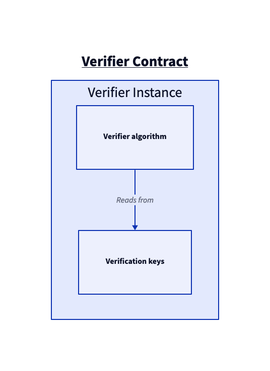

# Solidity verifier contracts and tests

This folder holds the Solidity UltraHonk verifiers that `bb write_solidity_verifier` emits, and their Foundry tests. [Noir](https://github.com/noir-lang/noir) programs use these verifiers for on-chain proof verification.

Each verifier has three parts: the verification algorithm (`BaseHonkVerifier.sol` / `BaseZKHonkVerifier.sol`, the same for every circuit), a circuit-specific verification key, and an instance contract in `src/honk/instance/` that combines the two.



## Files

### Core verifier (`src/honk/`)

| File | Purpose |
|------|---------|
| `HonkTypes.sol` | Defines structs: `VerificationKey`, `RelationParameters`, `Proof`, `G1Point` |
| `Fr.sol` | Field arithmetic library for BN254 scalar field |
| `Transcript.sol` | Fiat-Shamir challenge generation (non-ZK) |
| `ZKTranscript.sol` | Fiat-Shamir challenge generation (ZK variant) |
| `Relations.sol` | Constraint relation evaluations (arithmetic, permutation, lookup, memory, etc.) |
| `CommitmentScheme.sol` | KZG commitment verification |
| `BaseHonkVerifier.sol` | Main verifier logic (non-ZK) |
| `BaseZKHonkVerifier.sol` | Main verifier logic (ZK variant) |
| `Errors.sol`, `utils.sol`, `../interfaces/IVerifier.sol` | Shared errors, helpers and the verifier interface |

### Verification keys (`src/honk/keys/`)

Generated by `scripts/init_honk.sh` with `honk_solidity_key_gen`; not committed. One key per test circuit:
- `Add2HonkVerificationKey.sol` - Simple addition circuit
- `BlakeHonkVerificationKey.sol` - Blake hash circuit
- `EcdsaHonkVerificationKey.sol` - ECDSA verification circuit
- `RecursiveHonkVerificationKey.sol` - Recursive proof circuit

### Optimized verifiers (`src/honk/optimised/`)

Hand-optimized assembly verifiers, tested with the Blake circuit:
- `honk-optimized.sol.template` - non-ZK template; `scripts/sync_blake_opt_vk.sh` writes the instance `src/honk/instance/BlakeHonkOpt.sol`
- `zk-honk-optimized.sol.template` - ZK template; written to `src/honk/instance/BlakeOptZK.sol`

Both instance files are generated and gitignored.

### C++ contract templates (`cpp/src/barretenberg/dsl/acir_proofs/`)

These hpp files embed the Solidity code that `bb write_solidity_verifier` emits:
- `honk_contract.hpp` - Honk verifier
- `honk_zk_contract.hpp` - ZK Honk verifier
- `honk_optimized_contract.hpp` - Optimized verifier
- `honk_zk_optimized_contract.hpp` - Optimized ZK verifier

`CLAUDE.md` in this folder gives the regeneration order that keeps them in sync with the Solidity sources.

### Tests (`test/honk/`)

| Test file | Circuit | Description |
|-----------|---------|-------------|
| `Add2.t.sol` | add2 | Simple x + y = z |
| `Blake.t.sol` | blake | Blake2 hash |
| `blakeOpt.t.sol`, `blakeOptZK.t.sol` | blake | Optimized verifiers |
| `ECDSA.t.sol` | ecdsa | Signature verification |
| `Recursive.t.sol` | recursive | Recursive proof |
| `*ZK.t.sol` | * | ZK variants |
| `negative/*` | * | Proofs that must be rejected |

## Prerequisites

- A built `barretenberg/cpp/build/bin/honk_solidity_key_gen` (from `barretenberg/cpp` bootstrap).
- The BN254 CRS in `~/.bb-crs`.
- The solc binary `l1-contracts/solc-0.8.30` (`foundry.toml` points at it), so bootstrap `l1-contracts` first.

## Build and test

Run from `barretenberg/sol`:

```bash
./bootstrap.sh   # generate VKs (init_honk.sh), check the C++ templates are synced, forge install, forge build
forge test --no-match-contract Base   # the CI command; add -v ... -vvvv for logs
```

Run one contract or one test:

```bash
forge test --match-contract <NAME_OF_CONTRACT>   # e.g. BlakeHonkTest
forge test --match-test <NAME_OF_TEST>           # e.g. testValidProof
```

`foundry.toml` sets 2 fuzz runs to keep CI cheap. Raise `[fuzz] runs` locally when you need more.

Gas benchmark: `./bootstrap.sh bench` runs the `testValidProof` tests with `FORGE_GAS_REPORT=true` and writes the median gas of `verify` per contract to `bench-out/verifier.bench.json`.

## Debugging in assembly

Debugging from inside the assembly can be pretty inconvenient. The quickest way to get going is to add a custom error:

```solidity
bytes4 internal constant ERR_S = 0xf7b44074;
error ERR(bytes32,bytes32,bytes32);
```

Where `ERR_S` is the selector (first 4 bytes of keccak256(function signature)).

To revert the contract, and print values, you can then do as

```solidity
mstore(0x00, ERR_S) // put the selector in memory
mstore(0x04, val_1) // add first value after selector
mstore(0x24, val_2) // add second value after first
mstore(0x44, val_3) // add third value after second
revert(0x00, 0x64)  // revert with a message containing 0x64 bytes defined above
```

When running a test, you will then see the three values `val_1, val_2, val_3` in the console.
